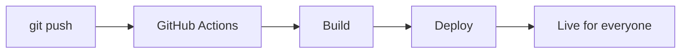

Hey there,
I'm an AI developer based in India building AI-first systems and scaling digital ventures.

---

## What I'm Building

**[CyberSAVVY SMMA](https://cybersavvysmma.com/)** (Co-owner)
AI marketing agency for local businesses: autonomous lead generation, branding, and custom client-acquisition systems.

**[Rakibul AI Labs](https://rakibuilds.github.io/)** (Founder)
My own AI lab: local LLMs, self-hosted AI stacks, and experiments with anything that can be built using AI.

---

## How I Work

```text
+----------+    +----------+    +----------+    +----------+    +----------+
|   IDEA   | -> | VALIDATE | -> |  BUILD   | -> |   TEST   | -> |   SHIP   |
|          |    | with AI  |    |AI assist |    |          |    |          |
+----------+    +----------+    +----------+    +----------+    +----------+
      ^                                                               |
      |                                                               |
      +----------------------- LEARN & IMPROVE -----------------------+
```

From a git push to a live site, with no manual steps:



---

## Tech Stack

<p align="center">
  <b>Languages</b><br/>
  
  
  
  
  
  
</p>

<p align="center">
  <b>Frontend and Mobile</b><br/>
  
  
  
  
  
  
  
  
</p>

<p align="center">
  <b>Backend and Databases</b><br/>
  
  
  
  
  
  
  
  
</p>

<p align="center">
  <b>Cloud and DevOps</b><br/>
  
  
  
  
  
  
  
  
</p>

<p align="center">
  <b>Tools</b><br/>
  
  
  
</p>

<p align="center">
  <b>Generative AI</b><br/>
  
  
  
  
  
</p>

---

## Connect

<div align="center">

[](https://x.com/rakibuilds)
[](https://www.linkedin.com/in/rakibul4210i)
[](https://github.com/rakibuilds)
[](https://substack.com/@rakibulia)
[](https://rakibulia.medium.com/)

</div>
